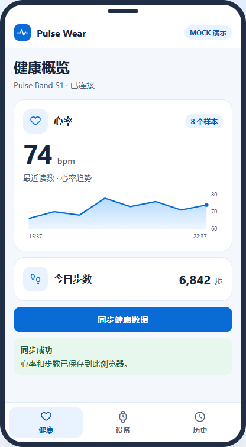

<div align="center">
  
  <h1>Pulse Wear</h1>
  <p>一款开源的穿戴设备模拟应用，提供原生 Android 版和可交互的网页手机视图。</p>
  <p>
    <a href="https://jack01930.github.io/PulseWear/?view=app"></a>
    <a href="#运行-android-版"></a>
    <a href="app/build.gradle.kts"></a>
    <a href="LICENSE"></a>
  </p>
  <a href="https://jack01930.github.io/PulseWear/?view=app">
    
  </a>
  <p><strong><a href="https://jack01930.github.io/PulseWear/?view=app">点击截图，直接体验 App ↗</a></strong></p>
  <p><a href="#功能">功能</a> · <a href="#快速开始">快速开始</a> · <a href="#项目结构">项目结构</a></p>
</div>

## 功能

| 功能 | 可以体验的操作 |
| --- | --- |
| 发现与连接 | 扫描并连接模拟手环 Pulse Band S1，查看型号、固件、电量和信号 |
| 健康同步 | 同步心率和步数，在健康页查看心率趋势 |
| 本地历史 | 按设备和日期查看快照，重复同步更新当日记录 |
| 超时恢复 | 在设备页开启「模拟下次同步超时」，发起同步，再点击「重试同步」 |

两种版本均使用示例设备和健康数据。网页版把历史保存在当前浏览器，Android 版保存到应用私有存储。

## 快速开始

### 在线体验

打开[手机视图](https://jack01930.github.io/PulseWear/?view=app)，在「设备」页扫描并连接手环，进入「健康」页同步数据，再到「历史」查看记录。

### 本地运行网页版

在项目根目录启动静态文件服务。

```sh
python -m http.server 8080 --directory docs
```

浏览器打开 `http://localhost:8080/?view=app` 即可操作。

### 运行 Android 版

用 Android Studio 打开项目根目录，使用 IDE 自带 JDK 或 JDK 17 及以上，安装 Android SDK 35，选择 Android 8.1（API 27）及以上的设备或模拟器运行 `app`。[Android Gradle Plugin 8.11 工具链要求](https://developer.android.com/build/releases/agp-8-11-0-release-notes)

在已配置 `JAVA_HOME` 和 `ANDROID_HOME` 的 PowerShell 中，也可构建调试 APK。

```powershell
.\gradlew.bat :app:assembleDebug
```

构建产物在 `app/build/outputs/apk/debug/app-debug.apk`。

## 项目结构

| 位置 | 职责 |
| --- | --- |
| [`app/`](app/) | Kotlin 与原生 Android View 界面 |
| [`WearableClient.kt`](app/src/main/java/app/pulse/wear/WearableClient.kt) | 设备访问接口和 Mock 客户端，模拟发现、连接准备、回包与超时 |
| [`HealthHistory.kt`](app/src/main/java/app/pulse/wear/HealthHistory.kt) | 通过 SharedPreferences 持久化每日快照 |
| [`docs/`](docs/) | 无构建步骤的静态网页，由 GitHub Pages 从 `main` 分支发布 |

Android 版参考 Restore 的设备卡片、底部导航、大数字读数和趋势图。[AI 使用说明](AI-USAGE.md)

## 许可证

本项目采用 [MIT 许可证](LICENSE)。
